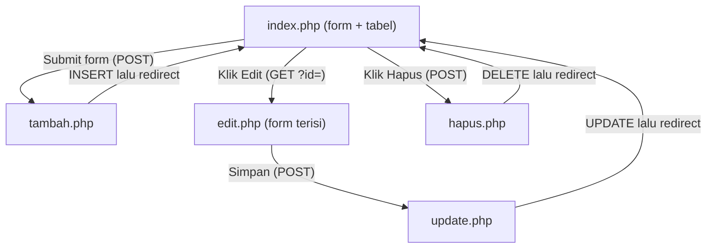

# 📘 Breakdown Kode Aplikasi iService (CRUD PHP + MySQL)

Dokumen ini menjelaskan **setiap baris kode** pada aplikasi iService untuk **mahasiswa pemula yang baru belajar PHP**. Semua istilah asing dan simbol (syntax) dijelaskan satu per satu.

> 💡 **Cara membaca dokumen ini:** Baca **Bagian 0 (Konsep Dasar)** terlebih dahulu. Setelah itu baca file sesuai urutan alur program: `database.sql` → `koneksi.php` → `fungsi.php` → `index.php` → `tambah.php` → `edit.php` → `update.php` → `hapus.php` → `logic.js`.

---

## 📑 Daftar Isi

0. [Konsep Dasar yang Wajib Dipahami](#0-konsep-dasar-yang-wajib-dipahami)
1. [database.sql — Membuat Database & Tabel](#1-databasesql--membuat-database--tabel)
2. [koneksi.php — Menghubungkan PHP ke Database](#2-koneksiphp--menghubungkan-php-ke-database)
3. [fungsi.php — Kumpulan Fungsi Bantu](#3-fungsiphp--kumpulan-fungsi-bantu)
4. [index.php — Halaman Utama (READ + Form CREATE)](#4-indexphp--halaman-utama-read--form-create)
5. [tambah.php — Proses CREATE](#5-tambahphp--proses-create)
6. [edit.php — Form UPDATE](#6-editphp--form-update)
7. [update.php — Proses UPDATE](#7-updatephp--proses-update)
8. [hapus.php — Proses DELETE](#8-hapusphp--proses-delete)
9. [logic.js — Tombol Hitung Harga](#9-logicjs--tombol-hitung-harga)
10. [Kamus Istilah (Glosarium)](#10-kamus-istilah-glosarium)

---

## 0. Konsep Dasar yang Wajib Dipahami

### 0.1 Apa itu CRUD?

**CRUD** adalah singkatan dari 4 operasi dasar pengolahan data:

| Huruf | Kepanjangan | Arti | Perintah SQL | File di aplikasi ini |
|---|---|---|---|---|
| **C** | Create | Membuat/menambah data | `INSERT` | `tambah.php` |
| **R** | Read | Membaca/menampilkan data | `SELECT` | `index.php`, `edit.php` |
| **U** | Update | Mengubah data | `UPDATE` | `edit.php` + `update.php` |
| **D** | Delete | Menghapus data | `DELETE` | `hapus.php` |

### 0.2 Bagaimana PHP bekerja?

1. Pengguna membuka `http://localhost:8000/index.php` di **browser** (Chrome, Firefox, dll).
2. Browser mengirim **request** (permintaan) ke **server** (komputer yang menjalankan PHP).
3. Server menjalankan kode PHP: mengambil data dari database, lalu menyusun HTML.
4. Server mengirim **response** (jawaban) berupa HTML jadi ke browser.
5. Browser menampilkan HTML tersebut.

> ⚠️ Kode PHP **tidak pernah terlihat** oleh pengguna di browser. Yang terlihat hanya hasil akhirnya (HTML). Kode PHP dijalankan di **server** (disebut *server-side*), sedangkan JavaScript dijalankan di **browser** (disebut *client-side*).

### 0.3 Alur program aplikasi ini



### 0.4 Syntax dasar PHP yang sering muncul

| Syntax | Nama | Penjelasan |
|---|---|---|
| `<?php` | Tag pembuka PHP | Menandai bahwa mulai dari sini adalah kode PHP. Semua kode di luar tag ini dianggap HTML biasa. |
| `?>` | Tag penutup PHP | Menandai akhir kode PHP. Di file yang **isinya murni PHP**, tag ini sengaja **tidak ditulis** agar tidak ada spasi/enter yang ikut terkirim ke browser secara tidak sengaja (bisa menyebabkan error pada `header()`). |
| `;` | Titik koma | Penanda **akhir sebuah perintah**. Setiap perintah PHP wajib diakhiri `;`, seperti titik pada akhir kalimat. |
| `$nama` | Variabel | Tanda `$` menandakan **variabel**, yaitu "kotak" untuk menyimpan data. Nama variabel bersifat *case-sensitive* (`$Nama` ≠ `$nama`). |
| `=` | Operator penugasan (*assignment*) | Memasukkan nilai di sebelah **kanan** ke variabel di sebelah **kiri**. `$a = 5;` artinya "isi `$a` dengan 5". **Bukan** "sama dengan" dalam matematika. |
| `"teks"` / `'teks'` | String | Data berupa teks diapit tanda kutip. |
| `//` | Komentar satu baris | Teks setelah `//` diabaikan oleh PHP. Dipakai untuk catatan programmer. |
| `/* ... */` dan `/** ... */` | Komentar banyak baris | Semua teks di antaranya diabaikan PHP. `/** */` biasa disebut *DocBlock*, dipakai untuk dokumentasi. |
| `( )` | Kurung biasa | Dipakai untuk memanggil fungsi `namaFungsi(...)`, mengelompokkan operasi, atau kondisi `if (...)`. |
| `{ }` | Kurung kurawal | Menandai **blok kode** (sekumpulan perintah) milik `if`, `function`, `foreach`, dll. |
| `[ ]` | Kurung siku | Membuat **array** atau mengakses isi array: `$data["nama"]`. |
| `.` | Operator penggabungan (*concatenation*) | Menyambung string: `"Halo " . "Budi"` → `"Halo Budi"`. |
| `->` | Operator objek | Memanggil fungsi (method) milik sebuah **objek**: `$tanggal->format(...)`. |
| `=>` | Panah array | Memasangkan **kunci** dengan **nilai** dalam array: `"nama" => "Budi"`. |

### 0.5 Tipe data dasar

| Tipe | Contoh | Penjelasan |
|---|---|---|
| `string` | `"Budi"` | Teks |
| `int` (integer) | `150000` | Bilangan bulat |
| `bool` (boolean) | `true` / `false` | Benar atau salah |
| `null` | `null` | "Kosong / tidak ada nilai" |
| `array` | `["a", "b"]` | Kumpulan banyak nilai dalam satu variabel |

### 0.6 Operator perbandingan & logika

| Operator | Arti | Contoh |
|---|---|---|
| `===` | **Identik**: nilai **dan** tipe data sama | `5 === 5` → `true`, `5 === "5"` → `false` |
| `!==` | **Tidak identik** | `"GET" !== "POST"` → `true` |
| `<=` | Kurang dari atau sama dengan | `0 <= 0` → `true` |
| `!` | **NOT** (kebalikan) | `!true` → `false` |
| `\|\|` | **OR** (atau): `true` jika salah satu benar | `false \|\| true` → `true` |
| `??` | **Null coalescing**: pakai nilai kiri jika ada & tidak `null`, kalau tidak pakai nilai kanan | `$_GET["id"] ?? 0` |
| `? :` | **Ternary**: `kondisi ? jikaBenar : jikaSalah` | `$umur >= 17 ? "dewasa" : "anak"` |
| `++` | Tambah 1 | `$no++` sama dengan `$no = $no + 1` |

> 💡 Kenapa memakai `===` dan bukan `==`? Operator `==` hanya membandingkan nilai dan mencoba "mengubah tipe" secara otomatis, sehingga hasilnya kadang mengejutkan. `===` lebih ketat dan lebih aman.

---

## 1. database.sql — Membuat Database & Tabel

File ini bukan PHP, melainkan **SQL** (*Structured Query Language*), yaitu bahasa untuk berkomunikasi dengan database. File ini dijalankan **sekali saja** untuk menyiapkan tempat penyimpanan data.

```sql
-- =====================================================================
-- database.sql
-- ...
```
- `--` adalah tanda **komentar di SQL** (sama seperti `//` di PHP). Baris ini diabaikan oleh database.

```sql
CREATE DATABASE IF NOT EXISTS db_iservice
    CHARACTER SET utf8mb4
    COLLATE utf8mb4_unicode_ci;
```
- `CREATE DATABASE` → perintah untuk **membuat database** baru. Database ibarat sebuah "lemari arsip".
- `IF NOT EXISTS` → "**jika belum ada**". Mencegah error kalau database dengan nama yang sama sudah pernah dibuat.
- `db_iservice` → nama database. Awalan `db_` hanya kebiasaan penamaan agar mudah dikenali.
- `CHARACTER SET utf8mb4` → **set karakter** yang dipakai. `utf8mb4` mendukung semua huruf di dunia termasuk emoji 😀. (`mb4` = *multi-byte 4*, setiap karakter bisa memakai hingga 4 byte.)
- `COLLATE utf8mb4_unicode_ci` → **collation**: aturan membandingkan dan mengurutkan teks. `ci` = *case-insensitive*, artinya "Budi" dan "budi" dianggap sama saat dicari.
- `;` → akhir perintah SQL.

```sql
USE db_iservice;
```
- `USE` → "**gunakan** database ini". Perintah-perintah setelahnya akan dijalankan di dalam `db_iservice`.

```sql
CREATE TABLE IF NOT EXISTS tb_service (
```
- `CREATE TABLE` → membuat **tabel**. Tabel ibarat "laci" di dalam lemari arsip, berisi baris (*row*) dan kolom (*column*), mirip sheet Excel.
- `tb_service` → nama tabel (awalan `tb_` = *table*).
- `(` → awal daftar kolom.

```sql
    id            INT AUTO_INCREMENT PRIMARY KEY,
```
- `id` → nama kolom.
- `INT` → tipe data **integer** (bilangan bulat).
- `AUTO_INCREMENT` → nilainya **diisi otomatis bertambah 1** setiap ada data baru (1, 2, 3, ...). Kita tidak perlu mengisinya sendiri.
- `PRIMARY KEY` → **kunci utama**: nilai unik yang menjadi "nomor KTP" setiap baris. Tidak boleh ada dua baris dengan `id` yang sama. Kolom inilah yang dipakai untuk menunjuk data mana yang akan diedit/dihapus.
- `,` → pemisah antar kolom.

```sql
    nama          VARCHAR(100) NOT NULL,
```
- `VARCHAR(100)` → *variable character*: teks dengan panjang **maksimal 100 karakter**.
- `NOT NULL` → kolom **wajib diisi**, tidak boleh kosong (`NULL`).

```sql
    tgl_service   DATE         NOT NULL,
```
- `DATE` → tipe data **tanggal** dengan format `YYYY-MM-DD` (contoh: `2026-10-22`).

```sql
    jenis_device  VARCHAR(100) NOT NULL,
    jenis_service VARCHAR(50)  NOT NULL,
    keluhan       VARCHAR(50)  NOT NULL,
    nomor_hp      VARCHAR(20)  NOT NULL,
```
- Semua kolom teks dengan batas panjang berbeda.
- 💡 Kenapa `nomor_hp` memakai `VARCHAR` dan bukan `INT`? Karena nomor HP bisa diawali `0` atau `+62`. Jika disimpan sebagai angka, angka `0` di depan akan hilang.

```sql
    alamat        TEXT         NOT NULL,
```
- `TEXT` → teks panjang (hingga ±65.000 karakter), cocok untuk alamat.

```sql
    total_harga   INT          NOT NULL,
```
- Disimpan sebagai **angka murni** (misal `350000`), bukan `"Rp 350.000"`, agar bisa dihitung (dijumlah, dirata-rata, dll). Format "Rp" baru ditambahkan saat ditampilkan.

```sql
    created_at    TIMESTAMP DEFAULT CURRENT_TIMESTAMP
);
```
- `TIMESTAMP` → tipe data tanggal + jam.
- `DEFAULT` → **nilai bawaan** jika kolom tidak diisi.
- `CURRENT_TIMESTAMP` → waktu saat ini. Jadi kolom ini otomatis mencatat kapan data dibuat.
- Kolom terakhir **tidak** diberi koma.
- `);` → menutup daftar kolom dan mengakhiri perintah.

---

## 2. koneksi.php — Menghubungkan PHP ke Database

File ini membuka "jalur komunikasi" antara PHP dan MySQL. File ini akan dipanggil (`require`) oleh semua file lain yang butuh database.

```php
<?php
```
- Tag pembuka PHP. File ini murni PHP, jadi tidak ada tag penutup `?>` di akhir file.

```php
/**
 * koneksi.php
 * ...
 */
```
- Komentar *DocBlock* berisi penjelasan file. Diabaikan PHP.

```php
$host     = "localhost";
```
- `$host` → variabel berisi alamat server database.
- `"localhost"` → artinya "**komputer ini sendiri**". Database berada di komputer yang sama dengan PHP.
- Spasi tambahan sebelum `=` hanya untuk merapikan tampilan (agar sejajar), tidak berpengaruh.

```php
$user     = "iservice";
$password = "rahasia123";
```
- Username dan password untuk login ke MySQL. Kita memakai user khusus `iservice` (bukan `root`) supaya aplikasi hanya punya akses ke database miliknya sendiri. Ini disebut prinsip ***least privilege*** (hak akses seminimal mungkin).

```php
$database = "db_iservice";
```
- Nama database yang akan dipakai, sesuai yang dibuat di `database.sql`.

```php
mysqli_report(MYSQLI_REPORT_ERROR | MYSQLI_REPORT_STRICT);
```
- `mysqli` → *MySQL Improved*, yaitu **ekstensi** (fitur tambahan) PHP untuk berkomunikasi dengan MySQL. Semua fungsi yang berawalan `mysqli_` berasal dari ekstensi ini.
- `mysqli_report(...)` → fungsi untuk mengatur **cara mysqli melaporkan error**.
- `MYSQLI_REPORT_ERROR` → **konstanta** (nilai tetap yang sudah disediakan PHP, ditulis HURUF BESAR) yang artinya "laporkan error".
- `|` → operator ***bitwise OR***, di sini artinya "**gabungkan** kedua pengaturan".
- `MYSQLI_REPORT_STRICT` → ubah error menjadi ***exception***. Exception adalah "sinyal darurat" yang menghentikan program, dan bisa "ditangkap" memakai `try ... catch`.

```php
try {
```
- `try` → "**coba** jalankan kode di dalam blok `{ }` ini". Jika terjadi exception di dalamnya, program langsung lompat ke blok `catch`.

```php
    $koneksi = mysqli_connect($host, $user, $password, $database);
```
- `mysqli_connect(...)` → fungsi untuk **membuka koneksi** ke MySQL. Butuh 4 **parameter/argumen** (nilai yang dikirim ke fungsi) dengan urutan: host, user, password, nama database.
- Hasilnya (objek koneksi) disimpan di variabel `$koneksi`. Variabel inilah yang nanti dipakai di semua file lain untuk menjalankan query.

```php
    mysqli_set_charset($koneksi, "utf8mb4");
```
- Mengatur **set karakter** koneksi menjadi `utf8mb4`, sama dengan database, agar huruf khusus tidak berubah menjadi tanda `?` saat disimpan/dibaca.

```php
} catch (mysqli_sql_exception $e) {
```
- `}` → menutup blok `try`.
- `catch` → "**tangkap**" exception jika terjadi.
- `mysqli_sql_exception` → **jenis** exception yang ditangkap, yaitu error yang berasal dari mysqli.
- `$e` → variabel yang berisi detail error-nya.

```php
    die("Koneksi ke database gagal: " . $e->getMessage());
```
- `die(...)` → **menghentikan program** saat itu juga sambil menampilkan pesan.
- `.` → menyambung teks.
- `$e->getMessage()` → memanggil *method* `getMessage()` milik objek `$e` untuk mengambil **isi pesan error-nya** (misal "Access denied for user ...").

```php
}
```
- Menutup blok `catch`.

---

## 3. fungsi.php — Kumpulan Fungsi Bantu

File ini berisi data harga dan **fungsi** (*function*) yang dipakai berulang di banyak file. Prinsip ini disebut **DRY** (*Don't Repeat Yourself* = jangan menulis kode yang sama berulang kali).

### 3.1 Konstanta daftar harga

```php
const HARGA_SPAREPART = [
    "Ganti Baterai" => 100000,
    "Ganti LCD"     => 200000,
    "Ganti Camera"  => 300000,
    "Ganti Speaker" => 400000,
    "Ganti Mic"     => 500000,
];
```
- `const` → membuat **konstanta**, yaitu "variabel" yang nilainya **tidak bisa diubah** setelah dibuat. Konstanta ditulis tanpa `$` dan biasanya HURUF BESAR.
- `[ ... ]` → membuat **array**.
- Array ini adalah **array asosiatif**: setiap nilai punya **kunci (key)** berupa teks.
  - `"Ganti Baterai"` → kunci (*key*)
  - `=>` → pemasang kunci dengan nilai
  - `100000` → nilai (*value*)
- Cara membaca isinya: `HARGA_SPAREPART["Ganti LCD"]` → menghasilkan `200000`.
- Koma setelah elemen terakhir (`500000,`) diperbolehkan di PHP (*trailing comma*), memudahkan saat menambah elemen baru.

```php
const ONGKOS_JASA = [
    "Service Ringan" => 150000,
    "Service Berat"  => 300000,
];
```
- Sama seperti di atas, berisi ongkos jasa untuk setiap jenis service.

### 3.2 Fungsi `hitungTotalHarga()`

```php
function hitungTotalHarga($jenisService, $keluhan)
{
```
- `function` → kata kunci untuk **membuat fungsi**. Fungsi adalah sekumpulan kode yang diberi nama, dan bisa dipanggil berkali-kali.
- `hitungTotalHarga` → nama fungsi. Penulisan huruf kecil di awal lalu huruf besar di tiap kata baru disebut gaya ***camelCase***.
- `($jenisService, $keluhan)` → **parameter**: "wadah" untuk nilai yang dikirim saat fungsi dipanggil.
- `{` → awal isi fungsi.

```php
    if (!isset(ONGKOS_JASA[$jenisService]) || !isset(HARGA_SPAREPART[$keluhan])) {
        return null;
    }
```
- `if (kondisi) { ... }` → **percabangan**: jalankan isi `{ }` hanya **jika** kondisinya bernilai `true`.
- `isset(...)` → mengecek apakah sesuatu **ada dan tidak `null`**. Di sini: "apakah jenis service tersebut ada di daftar harga?"
- `!isset(...)` → kebalikannya: "apakah **tidak** ada?"
- `||` → **atau**.
- Arti keseluruhan: "Jika jenis service **tidak** terdaftar **ATAU** keluhan **tidak** terdaftar, maka ..."
- `return null;` → **hentikan fungsi** dan kembalikan nilai `null` (tanda "tidak valid").

```php
    return ONGKOS_JASA[$jenisService] + HARGA_SPAREPART[$keluhan];
}
```
- Jika lolos pengecekan, fungsi **mengembalikan** hasil penjumlahan ongkos jasa + harga sparepart.
- Contoh: `hitungTotalHarga("Service Ringan", "Ganti LCD")` → `150000 + 200000` → `350000`.

> 🔒 **Kenapa harga dihitung lagi di PHP padahal sudah dihitung di JavaScript?** Karena JavaScript berjalan di browser, pengguna bisa mengubahnya (lewat *Inspect Element*). Server **tidak boleh percaya** data harga dari browser, jadi harga yang disimpan selalu dihitung ulang oleh PHP.

### 3.3 Fungsi `formatRupiah()`

```php
function formatRupiah($angka)
{
    return "Rp " . number_format($angka, 0, ",", ".");
}
```
- `number_format(angka, desimal, pemisahDesimal, pemisahRibuan)` → fungsi bawaan PHP untuk memformat angka.
  - `$angka` → angka yang akan diformat
  - `0` → jumlah angka di belakang koma (0 = tanpa desimal)
  - `","` → tanda pemisah desimal (gaya Indonesia memakai koma)
  - `"."` → tanda pemisah ribuan (gaya Indonesia memakai titik)
- `"Rp " . ...` → disambung dengan teks `"Rp "` di depannya.
- Contoh: `formatRupiah(350000)` → `"Rp 350.000"`.

### 3.4 Fungsi `e()` — Pengaman XSS

```php
function e($teks)
{
    return htmlspecialchars((string) $teks, ENT_QUOTES, "UTF-8");
}
```
- `(string)` → ***type casting***: memaksa nilai diubah menjadi tipe string.
- `htmlspecialchars(...)` → mengubah karakter khusus HTML menjadi kode aman:
  - `<` → `&lt;`, `>` → `&gt;`, `&` → `&amp;`, `"` → `&quot;`, `'` → `&#039;`
- `ENT_QUOTES` → konstanta yang memerintahkan agar tanda kutip tunggal **dan** ganda ikut diubah.
- `"UTF-8"` → set karakter yang dipakai.

> 🔒 **Apa itu XSS (*Cross-Site Scripting*)?** Serangan dengan cara memasukkan kode JavaScript berbahaya ke dalam form. Misalnya seseorang mengisi nama dengan `<script>alert('hack')</script>`. Tanpa `e()`, script itu akan **dijalankan** di browser setiap orang yang membuka halaman. Dengan `e()`, teks itu hanya **ditampilkan** sebagai tulisan biasa.

### 3.5 Fungsi `selected()`

```php
function selected($nilai, $pilihan)
{
    return $nilai === $pilihan ? "selected" : "";
}
```
- Memakai **operator ternary** `kondisi ? A : B`.
- Arti: "Jika `$nilai` identik dengan `$pilihan`, kembalikan teks `"selected"`; jika tidak, kembalikan teks kosong `""`."
- Dipakai di `edit.php` agar pilihan dropdown `<select>` yang lama otomatis terpilih. Atribut HTML `selected` pada `<option>` membuat opsi tersebut terpilih.

### 3.6 Fungsi `ambilDataForm()` — Validasi Input

```php
function ambilDataForm()
{
```
- Fungsi tanpa parameter (kurungnya kosong).

```php
    $data = [
        "nama"          => trim($_POST["nama"] ?? ""),
        "tgl_service"   => trim($_POST["tgl_service"] ?? ""),
        ...
    ];
```
- `$_POST` → **variabel superglobal** (variabel bawaan PHP yang bisa diakses dari mana saja) yang berisi **data form yang dikirim dengan method POST**. Kuncinya sesuai atribut `name` di input HTML. Contoh: `<input name="nama">` → dibaca dengan `$_POST["nama"]`.
- `?? ""` → jika `$_POST["nama"]` tidak ada (misalnya form tidak mengirim field itu), pakai string kosong `""` agar tidak muncul error *"Undefined array key"*.
- `trim(...)` → menghapus **spasi, tab, dan enter** di awal & akhir teks. `"  Budi  "` → `"Budi"`.
- Semua hasil dikumpulkan ke array asosiatif `$data`.

```php
    foreach ($data as $nilai) {
        if ($nilai === "") {
            return null;
        }
    }
```
- `foreach (array as $item)` → **perulangan** yang mengambil isi array **satu per satu**. Setiap putaran, satu nilai dimasukkan ke variabel `$nilai`.
- Jika ada satu saja nilai yang kosong (`""`), fungsi langsung berhenti dan mengembalikan `null` (data tidak valid).

```php
    $tanggal = DateTime::createFromFormat("Y-m-d", $data["tgl_service"]);
```
- `DateTime` → ***class*** (cetak biru objek) bawaan PHP untuk mengolah tanggal.
- `::` → ***scope resolution operator***, untuk memanggil method **statis** (method milik class, bukan milik objek).
- `createFromFormat("Y-m-d", teks)` → membuat objek tanggal dari teks dengan format tertentu:
  - `Y` = tahun 4 digit, `m` = bulan 2 digit, `d` = tanggal 2 digit.
- Jika teks tidak sesuai format, hasilnya `false`.

```php
    if (!$tanggal || $tanggal->format("Y-m-d") !== $data["tgl_service"]) {
        return null;
    }
```
- `!$tanggal` → "jika `$tanggal` bernilai `false`" (format salah).
- `$tanggal->format("Y-m-d")` → mengubah objek tanggal kembali menjadi teks.
- Kenapa dibandingkan lagi? Karena PHP kadang "memperbaiki" tanggal yang tidak ada secara otomatis, contohnya `2026-02-31` diubah menjadi `2026-03-03`. Jika hasilnya berbeda dengan input aslinya, berarti tanggal tersebut **tidak valid**.

```php
    $total = hitungTotalHarga($data["jenis_service"], $data["keluhan"]);
    if ($total === null) {
        return null;
    }
    $data["total_harga"] = $total;
```
- Memanggil fungsi `hitungTotalHarga()`. Jika hasilnya `null`, data tidak valid.
- `$data["total_harga"] = $total;` → **menambah** elemen baru ke array `$data` dengan kunci `"total_harga"`.

```php
    return $data;
}
```
- Jika semua pengecekan lolos, kembalikan array `$data` yang sudah bersih dan lengkap.

---

## 4. index.php — Halaman Utama (READ + Form CREATE)

File ini menggabungkan **PHP** (bagian atas) dan **HTML** (bagian bawah).

### 4.1 Bagian PHP di atas

```php
require "koneksi.php";
require "fungsi.php";
```
- `require` → **memasukkan dan menjalankan** isi file lain di posisi ini. Seolah-olah isi `koneksi.php` disalin ke sini. Setelah baris ini, variabel `$koneksi` dan semua fungsi di `fungsi.php` bisa dipakai.
- Jika file tidak ditemukan, `require` akan **menghentikan program** (*fatal error*). Bedanya dengan `include`: `include` hanya memberi peringatan lalu tetap lanjut.

```php
$daftarPesan = [
    "tambah"          => ["Data berhasil ditambahkan!", "sukses"],
    "edit"            => ["Data berhasil diperbarui!", "sukses"],
    "hapus"           => ["Data berhasil dihapus!", "sukses"],
    "gagal"           => ["Data gagal diproses, periksa kembali isian formulir!", "gagal"],
    "tidak_ditemukan" => ["Data tidak ditemukan!", "gagal"],
];
```
- **Array bersarang** (*nested array*): array yang isinya array lagi.
- Setiap kunci (misal `"tambah"`) berisi array 2 elemen: `[0]` = teks pesan, `[1]` = jenis pesan (untuk warna CSS).

```php
$pesan = $daftarPesan[$_GET["pesan"] ?? ""] ?? null;
```
- `$_GET` → superglobal berisi data dari **URL** (*query string*). Pada URL `index.php?pesan=tambah`, bagian setelah `?` adalah *query string*, sehingga `$_GET["pesan"]` bernilai `"tambah"`.
- Cara membacanya dari dalam ke luar:
  1. `$_GET["pesan"] ?? ""` → ambil nilai `pesan` dari URL, atau `""` jika tidak ada.
  2. `$daftarPesan[...]` → cari pesan dengan kunci tersebut.
  3. `?? null` → jika kunci tidak ditemukan di daftar, hasilnya `null` (tidak ada pesan).
- Hasil: `$pesan` berisi misalnya `["Data berhasil ditambahkan!", "sukses"]`, atau `null`.

```php
$hasil = mysqli_query($koneksi, "SELECT * FROM tb_service ORDER BY id ASC");
```
- `mysqli_query(koneksi, query)` → menjalankan **query SQL** langsung. Aman dipakai di sini karena query-nya **tidak mengandung input pengguna**.
- Penjelasan query:
  - `SELECT` → **ambil** data
  - `*` → **semua kolom**
  - `FROM tb_service` → dari tabel `tb_service`
  - `ORDER BY id` → **urutkan** berdasarkan kolom `id`
  - `ASC` → *ascending* (kecil ke besar). Kebalikannya `DESC` (*descending*).
- `$hasil` → objek ***result set***, yaitu kumpulan baris hasil query.

```php
?>
```
- Menutup PHP, karena setelah ini adalah HTML.

### 4.2 Bagian HTML: Form tambah

```html
<form id="iniForm" action="tambah.php" method="POST">
```
- `<form>` → elemen formulir.
- `action="tambah.php"` → saat form disubmit, data **dikirim ke** file `tambah.php`.
- `method="POST"` → cara pengiriman data:
  - **POST**: data dikirim "tersembunyi" di dalam badan *request*, tidak tampil di URL. Dipakai untuk **mengubah data** (tambah/edit/hapus).
  - **GET**: data ditempel di URL (`?id=3`). Dipakai untuk **mengambil/menampilkan** data.

```html
<input type="text" id="nama" name="nama" required>
```
- `type="text"` → kotak isian teks.
- `id="nama"` → identitas unik, dipakai oleh CSS, JavaScript, dan `<label for="nama">`.
- `name="nama"` → **kunci yang dibaca PHP**: `$_POST["nama"]`. ⚠️ **Tanpa atribut `name`, data input tidak akan terkirim ke PHP!**
- `required` → browser menolak submit jika kotak ini kosong (validasi sisi browser).

```html
<select id="jenisService" name="jenis_service" required>
    <option value="">Pilih jenis service</option>
    <option value="Service Ringan">Service Ringan</option>
```
- `<select>` → dropdown pilihan.
- `<option value="...">` → setiap pilihan. Yang dikirim ke PHP adalah isi atribut **`value`**, bukan teks yang terlihat.
- Opsi pertama `value=""` (kosong) + `required` → memaksa pengguna memilih salah satu opsi.

```html
<input type="text" id="totalHarga" readonly>
```
- `readonly` → hanya bisa dibaca, tidak bisa diketik.
- Input ini **tidak punya `name`**, jadi **tidak dikirim** ke PHP. Memang disengaja, karena harga dihitung ulang oleh PHP.

### 4.3 Menampilkan pesan notifikasi

```php
<?php if ($pesan): ?>
    <p id="validasiPesanan" class="pesan pesan-<?= $pesan[1] ?>"><?= e($pesan[0]) ?></p>
<?php endif; ?>
```
- `if (...):` ... `endif;` → **syntax alternatif** dari `if (...) { ... }`. Lebih mudah dibaca saat bercampur dengan HTML.
- `if ($pesan)` → jika `$pesan` berisi sesuatu (bukan `null`), tampilkan paragraf.
- `<?= ... ?>` → singkatan dari `<?php echo ...; ?>`, artinya **cetak nilai** ke HTML.
- `pesan-<?= $pesan[1] ?>` → menghasilkan class `pesan-sukses` atau `pesan-gagal` (warnanya diatur di `style.css`).
- `e($pesan[0])` → mencetak teks pesan secara aman.

### 4.4 Menampilkan tabel data (READ)

```php
<?php if (mysqli_num_rows($hasil) === 0): ?>
    <tr>
        <td colspan="10">Data masih kosong!</td>
    </tr>
```
- `mysqli_num_rows($hasil)` → menghitung **jumlah baris** hasil query.
- Jika 0, tampilkan baris "Data masih kosong!".
- `colspan="10"` → sel ini **melebar** sepanjang 10 kolom.

```php
<?php else: ?>
    <?php $no = 1; ?>
```
- `else:` → "jika tidak" (jika ada data).
- `$no = 1` → nomor urut tampilan dimulai dari 1. Ini **bukan** `id` database, karena `id` bisa "loncat" (misal 1, 2, 5) setelah ada data yang dihapus.

```php
    <?php while ($row = mysqli_fetch_assoc($hasil)): ?>
```
- `while (kondisi):` ... `endwhile;` → **perulangan** yang terus berjalan **selama** kondisinya `true`.
- `mysqli_fetch_assoc($hasil)` → mengambil **satu baris** data berikutnya dalam bentuk **array asosiatif** (kuncinya nama kolom). Contoh: `["id" => 1, "nama" => "Budi", ...]`.
- Jika baris sudah habis, fungsi ini mengembalikan `null`, sehingga perulangan berhenti.
- Jadi, perulangan ini berjalan **sebanyak jumlah baris** data.

```php
        <td><?= $no++ ?></td>
```
- Cetak `$no`, **lalu** tambah 1 (disebut *post-increment*). Baris pertama mencetak 1, baris kedua 2, dan seterusnya.

```php
        <td><?= e($row["nama"]) ?></td>
```
- Mencetak kolom `nama` dari baris saat ini secara aman (pakai `e()` untuk mencegah XSS).

```php
        <td><?= e(date("d-m-Y", strtotime($row["tgl_service"]))) ?></td>
```
- `strtotime("2026-10-22")` → mengubah teks tanggal menjadi ***timestamp*** (jumlah detik sejak 1 Januari 1970).
- `date("d-m-Y", timestamp)` → mengubah timestamp menjadi teks dengan format `hari-bulan-tahun`: `22-10-2026` (format Indonesia).

```php
        <td><?= e(formatRupiah($row["total_harga"])) ?></td>
```
- `350000` → `"Rp 350.000"`.

```php
        <a href="edit.php?id=<?= (int) $row["id"] ?>" class="btn btn-edit">Edit</a>
```
- `<a href="...">` → **link**.
- Menghasilkan link seperti `edit.php?id=3`, sehingga `edit.php` tahu data mana yang akan diedit.
- `(int)` → memastikan yang dicetak pasti angka.

```php
        <form action="hapus.php" method="POST"
            onsubmit="return confirm('Yakin ingin menghapus data ini?');">
            <input type="hidden" name="id" value="<?= (int) $row["id"] ?>">
            <button type="submit" class="btn btn-hapus">Hapus</button>
        </form>
```
- Setiap baris punya **form kecil** sendiri untuk menghapus.
- `onsubmit="..."` → kode JavaScript yang dijalankan **sebelum** form dikirim.
- `confirm('...')` → menampilkan kotak dialog OK/Cancel. Nilainya `true` jika OK, `false` jika Cancel.
- `return false` → **membatalkan** pengiriman form. Jadi jika pengguna klik Cancel, data tidak dihapus.
- `type="hidden"` → input **tersembunyi**: tidak terlihat di layar, tapi tetap dikirim ke PHP. Berisi `id` data yang akan dihapus.

```php
    <?php endwhile; ?>
<?php endif; ?>
```
- Menutup `while` dan `if`.

---

## 5. tambah.php — Proses CREATE

File ini **tidak menampilkan halaman**. Tugasnya hanya: terima data → simpan → kembali ke `index.php`.

```php
require "koneksi.php";
require "fungsi.php";
```
- Memuat koneksi database dan fungsi bantu (lihat penjelasan di [4.1](#41-bagian-php-di-atas)).

```php
if ($_SERVER["REQUEST_METHOD"] !== "POST") {
    header("Location: index.php");
    exit;
}
```
- `$_SERVER` → superglobal berisi informasi tentang **server dan request**.
- `$_SERVER["REQUEST_METHOD"]` → method yang dipakai untuk mengakses halaman ini: `"GET"` atau `"POST"`.
- Arti: "Jika file ini **tidak** diakses lewat pengiriman form POST (misalnya seseorang mengetik langsung `tambah.php` di address bar), maka ..."
- `header("Location: index.php")` → mengirim perintah ke browser untuk **pindah halaman** (***redirect***) ke `index.php`.
- `exit;` → **menghentikan** program. ⚠️ Wajib ditulis setelah `header("Location: ...")`, karena tanpa `exit` kode di bawahnya tetap dijalankan.

```php
$data = ambilDataForm();
if ($data === null) {
    header("Location: index.php?pesan=gagal");
    exit;
}
```
- Memanggil fungsi validasi dari `fungsi.php`.
- Jika data tidak valid → redirect ke `index.php?pesan=gagal` (akan muncul pesan merah).

```php
$sql = "INSERT INTO tb_service
            (nama, tgl_service, jenis_device, jenis_service, keluhan, nomor_hp, alamat, total_harga)
        VALUES (?, ?, ?, ?, ?, ?, ?, ?)";
```
- Query disimpan dulu ke variabel `$sql`.
- `INSERT INTO tb_service` → **masukkan data** ke tabel `tb_service`.
- `(nama, tgl_service, ...)` → daftar kolom yang akan diisi. Kolom `id` dan `created_at` tidak ditulis karena terisi otomatis.
- `VALUES (?, ?, ...)` → nilai-nilainya. Tanda `?` adalah ***placeholder*** (tempat kosong) yang nanti diisi data asli. Jumlahnya 8, sama dengan jumlah kolom.

```php
$stmt = mysqli_prepare($koneksi, $sql);
```
- `mysqli_prepare()` → **menyiapkan** query (*prepared statement*). Database menerima "cetakan" query-nya terlebih dahulu, **terpisah** dari datanya.
- `$stmt` → singkatan *statement*, objek query yang sudah disiapkan.

> 🔒 **Apa itu SQL Injection dan kenapa memakai prepared statement?**
> Jika data pengguna langsung ditempel ke query, misalnya:
> `"DELETE FROM tb_service WHERE id = " . $_POST["id"]`
> maka penyerang bisa mengirim `1 OR 1=1`, sehingga query-nya menjadi `DELETE ... WHERE id = 1 OR 1=1` dan **semua data terhapus**!
> Dengan *prepared statement*, data dikirim terpisah dan **selalu dianggap sebagai data**, tidak pernah sebagai perintah SQL.

```php
mysqli_stmt_bind_param(
    $stmt,
    "sssssssi",
    $data["nama"],
    $data["tgl_service"],
    ...
    $data["total_harga"]
);
```
- `mysqli_stmt_bind_param()` → **mengikat** (*bind*) data ke setiap `?` sesuai urutan.
- `"sssssssi"` → **string tipe data**: setiap huruf mewakili satu `?` secara berurutan:
  - `s` = *string* (teks), `i` = *integer* (bilangan bulat), `d` = *double* (desimal), `b` = *blob* (data biner)
  - Di sini: 7 teks + 1 angka (`total_harga`).
- ⚠️ Jumlah huruf **harus sama** dengan jumlah `?` dan jumlah variabel setelahnya.

```php
mysqli_stmt_execute($stmt);
mysqli_stmt_close($stmt);
```
- `mysqli_stmt_execute()` → **menjalankan** query. Pada tahap inilah data benar-benar tersimpan ke database.
- `mysqli_stmt_close()` → **menutup** statement untuk membebaskan memori.

```php
header("Location: index.php?pesan=tambah");
exit;
```
- Kembali ke halaman utama dengan pesan sukses.

> 💡 **Pola PRG (*Post/Redirect/Get*)**: setelah menerima POST, server melakukan redirect ke halaman GET. Tujuannya agar data **tidak tersimpan dua kali** saat pengguna menekan tombol Refresh (F5).

---

## 6. edit.php — Form UPDATE

Menampilkan form yang **sudah terisi data lama**. Strukturnya mirip `index.php`.

```php
$id = (int) ($_GET["id"] ?? 0);
```
- Mengambil `id` dari URL (`edit.php?id=3` → `"3"`).
- `?? 0` → jika tidak ada `id` di URL, pakai `0`.
- `(int)` → mengubah menjadi angka. Jika berisi teks aneh seperti `"abc"`, hasilnya `0`. Ini lapisan keamanan tambahan.

```php
$stmt = mysqli_prepare($koneksi, "SELECT * FROM tb_service WHERE id = ?");
```
- `WHERE id = ?` → **filter**: ambil hanya baris yang `id`-nya sama dengan nilai placeholder.

```php
mysqli_stmt_bind_param($stmt, "i", $id);
mysqli_stmt_execute($stmt);
```
- Mengisi `?` dengan `$id` bertipe integer (`"i"`), lalu menjalankan query.

```php
$hasil = mysqli_stmt_get_result($stmt);
$row   = mysqli_fetch_assoc($hasil);
mysqli_stmt_close($stmt);
```
- `mysqli_stmt_get_result()` → mengambil **hasil** query SELECT dari statement.
- `mysqli_fetch_assoc()` → ambil satu baris sebagai array asosiatif. Jika data tidak ditemukan → `null`.

```php
if (!$row) {
    header("Location: index.php?pesan=tidak_ditemukan");
    exit;
}
```
- `!$row` → jika `$row` kosong/`null` (data tidak ada), kembali ke index.

```php
$pesanGagal = (($_GET["pesan"] ?? "") === "gagal")
    ? "Data gagal diperbarui, periksa kembali isian formulir!"
    : "";
```
- Ternary yang ditulis dalam beberapa baris agar mudah dibaca.
- Jika URL berisi `?pesan=gagal` (dikirim oleh `update.php`), isi variabel dengan pesan error. Jika tidak, isi dengan teks kosong.

```html
<input type="hidden" name="id" value="<?= (int) $row["id"] ?>">
```
- Menyimpan `id` secara tersembunyi di dalam form, supaya `update.php` tahu **baris mana** yang akan diubah.

```html
<input type="text" id="nama" name="nama" value="<?= e($row["nama"]) ?>" required>
```
- `value="..."` → **isi awal** input. Diisi data lama dari database sehingga pengguna tinggal mengubah bagian yang perlu.

```php
<?php foreach (ONGKOS_JASA as $nama => $harga): ?>
    <option value="<?= e($nama) ?>" <?= selected($row["jenis_service"], $nama) ?>><?= e($nama) ?></option>
<?php endforeach; ?>
```
- `foreach (array as $kunci => $nilai):` → perulangan yang mengambil **kunci dan nilai** sekaligus. Di sini `$nama` = `"Service Ringan"`, `$harga` = `150000`.
- Opsi dropdown dibuat **otomatis** dari konstanta, jadi cukup menambah harga di `fungsi.php` dan opsinya akan langsung muncul.
- `selected(...)` → menghasilkan `selected` pada opsi yang sama dengan data lama.

```html
<a href="index.php" class="btn btn-batal">Batal</a>
```
- Link untuk kembali tanpa menyimpan perubahan.

```html
<script src="logic.js"></script>
```
- Memuat file JavaScript agar tombol "Hitung Harga" berfungsi. Diletakkan di bagian akhir `<body>` agar elemen HTML sudah ada saat script dijalankan.

---

## 7. update.php — Proses UPDATE

Strukturnya hampir sama dengan `tambah.php`. Berikut bagian yang berbeda:

```php
$id = (int) ($_POST["id"] ?? 0);
```
- Mengambil `id` dari **input hidden** di form `edit.php` (lewat `$_POST`, bukan `$_GET`).

```php
if ($id <= 0 || $data === null) {
    header("Location: edit.php?id=$id&pesan=gagal");
    exit;
}
```
- Jika `id` tidak valid (`0` atau negatif) **atau** data form tidak valid → kembali ke halaman edit.
- `"edit.php?id=$id&pesan=gagal"` → di dalam **tanda kutip ganda**, PHP otomatis mengganti `$id` dengan nilainya (disebut ***string interpolation***). Contoh: `edit.php?id=3&pesan=gagal`. (Dengan kutip tunggal `'...'` hal ini **tidak** terjadi.)
- `&` → pemisah antar parameter di URL.

```php
$sql = "UPDATE tb_service SET
            nama = ?, tgl_service = ?, jenis_device = ?, jenis_service = ?,
            keluhan = ?, nomor_hp = ?, alamat = ?, total_harga = ?
        WHERE id = ?";
```
- `UPDATE tb_service` → **ubah data** di tabel `tb_service`.
- `SET kolom = ?` → kolom mana yang diubah beserta nilai barunya.
- `WHERE id = ?` → **hanya** baris dengan `id` tersebut. ⚠️ **Sangat penting!** Tanpa `WHERE`, **SEMUA baris** di tabel akan ikut berubah.

```php
mysqli_stmt_bind_param(
    $stmt,
    "sssssssii",
    ...
    $data["total_harga"],
    $id
);
```
- `"sssssssii"` → 7 string + 2 integer (`total_harga` dan `id`). Total 9, sama dengan jumlah `?`.

```php
header("Location: index.php?pesan=edit");
exit;
```
- Kembali ke index dengan pesan "Data berhasil diperbarui!".

---

## 8. hapus.php — Proses DELETE

```php
require "koneksi.php";
```
- Hanya butuh koneksi, karena tidak memakai fungsi dari `fungsi.php`.

```php
if ($_SERVER["REQUEST_METHOD"] !== "POST") {
    header("Location: index.php");
    exit;
}
```
- Hanya menerima POST. Kenapa hapus tidak memakai link biasa `hapus.php?id=1` (GET)? Karena link GET bisa terpanggil **tanpa sengaja**: dibuka ulang dari riwayat browser, di-*prefetch* (dimuat duluan) oleh browser, atau diklik dari link yang dikirim orang lain. Data bisa terhapus tanpa disadari.

```php
$id = (int) ($_POST["id"] ?? 0);
if ($id <= 0) {
    header("Location: index.php?pesan=gagal");
    exit;
}
```
- Ambil `id` dari input hidden dan pastikan bernilai angka positif.

```php
$stmt = mysqli_prepare($koneksi, "DELETE FROM tb_service WHERE id = ?");
mysqli_stmt_bind_param($stmt, "i", $id);
mysqli_stmt_execute($stmt);
mysqli_stmt_close($stmt);
```
- `DELETE FROM tb_service WHERE id = ?` → **hapus** baris dengan `id` tersebut. ⚠️ Sama seperti UPDATE, **tanpa `WHERE` semua data akan terhapus!**
- Sisanya: siapkan → isi `?` → jalankan → tutup.

```php
header("Location: index.php?pesan=hapus");
exit;
```
- Kembali ke index dengan pesan "Data berhasil dihapus!".

---

## 9. logic.js — Tombol Hitung Harga

File **JavaScript** ini berjalan di **browser**, hanya untuk menampilkan **perkiraan** harga sebelum form dikirim.

```js
const selectKeluhan = document.getElementById("keluhan");
const selectJenisService = document.getElementById("jenisService");
const totalHargaInput = document.getElementById("totalHarga");
```
- `const` → variabel yang **tidak bisa diisi ulang** (konstanta).
- `document` → objek yang mewakili **seluruh halaman HTML** (disebut **DOM**, *Document Object Model*).
- `getElementById("keluhan")` → mengambil elemen HTML yang memiliki `id="keluhan"`.

```js
const hargaSparepart = {
    "Ganti Baterai": 100000,
    ...
};
```
- `{ }` → **objek** JavaScript. Mirip array asosiatif PHP, tapi memakai `:` (bukan `=>`).
- ⚠️ Daftar harga ini **harus sama** dengan yang ada di `fungsi.php`. Jika mengubah harga, ubah di kedua file.

```js
btnHitung.addEventListener("click", function () {
```
- `addEventListener("click", fungsi)` → "**dengarkan** kejadian (*event*) klik pada tombol ini, lalu jalankan fungsi berikut."
- `function () { ... }` → **fungsi anonim** (fungsi tanpa nama), yang dijalankan setiap kali tombol diklik.

```js
    const keluhan = selectKeluhan.value;
```
- `.value` → mengambil nilai yang sedang dipilih/diisi pada elemen tersebut.

```js
    if (!keluhan || !hargaSparepart[keluhan]) {
        alert("Silakan pilih keluhan terlebih dahulu!");
        return;
    }
```
- Jika belum memilih keluhan → tampilkan peringatan `alert()` → `return` (hentikan fungsi).

```js
    const total = hargaSparepart[keluhan] + ongkosJasa[jenisService];
    totalHargaInput.value = "Rp " + total.toLocaleString("id-ID");
```
- Menjumlahkan harga.
- `+` → di JavaScript, operator `+` dipakai untuk **menjumlah angka** sekaligus untuk **menyambung teks** (di PHP, menyambung teks memakai `.`).
- `toLocaleString("id-ID")` → format angka gaya Indonesia: `350000` → `"350.000"`.

```js
selectKeluhan.addEventListener("change", () => totalHargaInput.value = "");
```
- `"change"` → event yang terjadi saat pilihan dropdown **diubah**.
- `() => ...` → ***arrow function***, cara singkat menulis fungsi.
- Saat pilihan berubah, kotak total dikosongkan agar pengguna menghitung ulang.

---

## 10. Kamus Istilah (Glosarium)

| Istilah | Arti Sederhana |
|---|---|
| **Argumen / Parameter** | Nilai yang dikirim ke fungsi. Parameter = "wadah" saat fungsi dibuat; argumen = nilai asli saat fungsi dipanggil. |
| **Array** | Variabel yang bisa menyimpan banyak nilai sekaligus. |
| **Array asosiatif** | Array yang setiap nilainya punya kunci berupa teks (`"nama" => "Budi"`). |
| **Boolean** | Tipe data yang hanya bernilai `true` (benar) atau `false` (salah). |
| **Browser** | Aplikasi untuk membuka web (Chrome, Firefox). Juga disebut *client*. |
| **Class** | "Cetak biru" untuk membuat objek. Contoh: `DateTime`. |
| **Client-side** | Kode yang berjalan di browser pengguna (HTML, CSS, JavaScript). |
| **Collation** | Aturan membandingkan dan mengurutkan teks di database. |
| **Concatenation** | Penggabungan teks (PHP: `.`, JavaScript: `+`). |
| **Konstanta** | Nilai tetap yang tidak bisa diubah setelah dibuat. |
| **CRUD** | Create, Read, Update, Delete: 4 operasi dasar data. |
| **Database** | Tempat penyimpanan data yang terstruktur. |
| **DOM** | *Document Object Model*: representasi halaman HTML yang bisa diolah JavaScript. |
| **DRY** | *Don't Repeat Yourself*: prinsip menghindari kode berulang. |
| **Echo** | Perintah PHP untuk mencetak/menampilkan teks ke HTML. `<?= ?>` adalah singkatannya. |
| **Escape** | Mengubah karakter berbahaya menjadi bentuk aman (dilakukan oleh `htmlspecialchars`). |
| **Event** | Kejadian di browser: klik, ketik, ubah pilihan, dll. |
| **Exception** | Sinyal error yang bisa ditangkap dengan `try...catch`. |
| **Ekstensi** | Fitur tambahan PHP yang perlu dipasang terpisah, contohnya `mysqli`. |
| **Fetch** | Mengambil baris data dari hasil query. |
| **Fungsi (function)** | Kumpulan kode yang diberi nama dan bisa dipanggil berulang kali. |
| **GET** | Method HTTP yang mengirim data lewat URL. Dipakai untuk mengambil data. |
| **Hidden input** | Input form yang tidak terlihat tapi tetap ikut terkirim. |
| **HTTP** | Protokol (aturan) komunikasi antara browser dan server. |
| **Integer** | Bilangan bulat (tanpa koma). |
| **Least privilege** | Prinsip memberi hak akses seminimal mungkin. |
| **localhost** | Alamat yang menunjuk ke komputer sendiri. |
| **Method (objek)** | Fungsi yang dimiliki oleh sebuah objek/class, dipanggil dengan `->` atau `::`. |
| **MySQL / MariaDB** | Software database relasional yang populer. |
| **mysqli** | Ekstensi PHP untuk berkomunikasi dengan MySQL. |
| **Null** | Nilai khusus yang berarti "kosong/tidak ada". |
| **Objek** | "Benda" dalam program yang punya data dan fungsi (method). |
| **Placeholder** | Tempat kosong `?` di query yang nanti diisi data. |
| **POST** | Method HTTP yang mengirim data di badan request. Dipakai untuk mengubah data. |
| **Prepared statement** | Query yang "dicetak" dulu, lalu datanya diisi terpisah. Mencegah SQL Injection. |
| **PRG** | *Post/Redirect/Get*: pola redirect setelah POST agar data tidak terkirim dua kali. |
| **Primary key** | Kolom unik sebagai identitas setiap baris (biasanya `id`). |
| **Query** | Perintah yang dikirim ke database (SELECT, INSERT, UPDATE, DELETE). |
| **Query string** | Bagian URL setelah tanda `?`, contoh: `?id=3&pesan=gagal`. |
| **Redirect** | Mengalihkan browser ke halaman lain. |
| **Request / Response** | Permintaan dari browser ke server / jawaban dari server ke browser. |
| **Result set** | Kumpulan baris hasil query SELECT. |
| **Server** | Komputer/program yang menjalankan PHP dan melayani request. |
| **Server-side** | Kode yang berjalan di server (PHP). |
| **SQL** | *Structured Query Language*: bahasa untuk mengelola database. |
| **SQL Injection** | Serangan dengan menyisipkan perintah SQL berbahaya lewat input. |
| **String** | Data berupa teks. |
| **Superglobal** | Variabel bawaan PHP yang bisa diakses di mana saja: `$_GET`, `$_POST`, `$_SERVER`. |
| **Tabel** | Struktur penyimpanan data berupa baris dan kolom di dalam database. |
| **Ternary** | Percabangan singkat: `kondisi ? jikaBenar : jikaSalah`. |
| **Timestamp** | Representasi waktu (tanggal + jam). |
| **Type casting** | Mengubah tipe data secara paksa, misalnya `(int)` atau `(string)`. |
| **Validasi** | Pengecekan apakah data yang dimasukkan benar dan lengkap. |
| **Variabel** | "Kotak" penyimpan data, di PHP diawali tanda `$`. |
| **XSS** | *Cross-Site Scripting*: serangan dengan menyisipkan JavaScript berbahaya ke halaman web. |

---

> 🎓 **Tips belajar:** Coba ubah sedikit kode (misalnya menambah jenis keluhan baru di `fungsi.php` dan `logic.js`), lalu perhatikan apa yang berubah di browser. Cara terbaik memahami kode adalah dengan **mencoba dan bereksperimen**!
